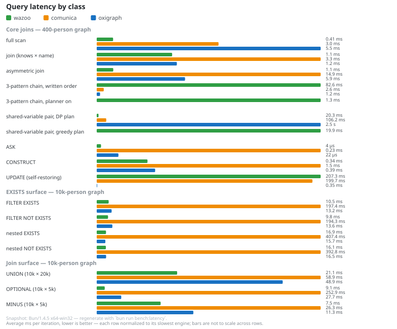
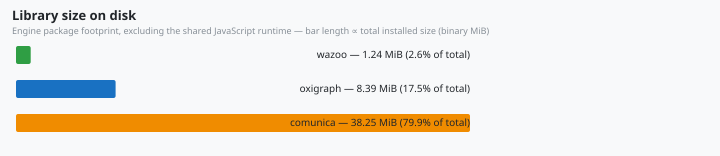
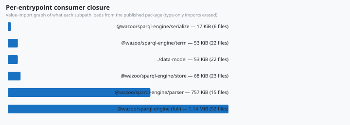
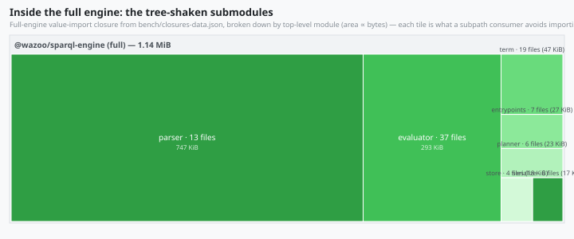
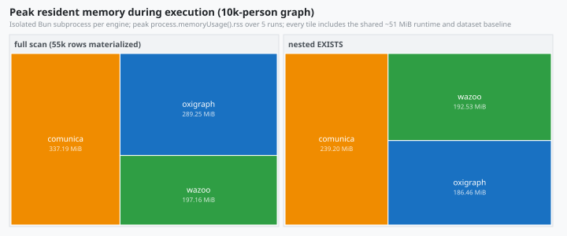

# Benchmarking & Performance

The engine ships nine benchmark surfaces — one latency comparison, one CI
regression gate, one concurrency stress probe, three footprint measurers
(on-disk size, per-entrypoint closure, and peak memory), a latency-chart renderer,
a latency-snapshot freshness gate, and a durable-store benchmark. This page
documents the methodology behind each — how a measurement is made trustworthy,
what a gate measures, and how to run it. Run instructions live in
[05 — Verification & Testing](05-testing.md).

**The measured numbers live in the root `README.md`** (Size & memory footprint,
Latency), regenerated from `bench/*-data.json` and rendered into the committed
`docs/assets/*.svg` charts. The wiki deliberately does not duplicate them:
latency, size, and peak-memory values are machine-specific snapshots (runtime
version, hardware, run-to-run noise) that go stale without telling a reader
anything structural. Run `bun run bench`, `bun run bench:size`, or
`bun run bench:memory` for your own numbers.

| Tool                         | Task                          | Measures                                                                             | Gate |
| ---------------------------- | ----------------------------- | ------------------------------------------------------------------------------------ | ---- |
| `bench/engine_bench.ts`      | `bun run bench`               | Query/update latency vs [Comunica](https://comunica.dev/) + Oxigraph                 | no   |
| `bench/budget.ts`            | `bun run bench:check`         | Query latency regression gate (per-row budgets; rows recorded to the CI job summary) | CI   |
| `bench/concurrency-probe.ts` | (manual)                      | EXISTS snapshot isolation under concurrency                                          | no   |
| `bench/measure-libs.ts`      | `bun run bench:size`          | On-disk footprint of each engine                                                     | no   |
| `bench/measure-closures.ts`  | `bun run bench:size:closures` | Per-entrypoint import closure (what each subpath loads)                              | no   |
| `bench/collect-memory.ts`    | `bun run bench:memory`        | Peak memory during execution                                                         | no   |
| `bench/latency-chart.ts`     | `bun run bench:latency`       | Renders the `--json` latency snapshot into `docs/assets/chart-latency.svg`           | no   |
| `bench/latency-check.ts`     | `bun run bench:latency:check` | Fails when the committed snapshot's bench inventory is stale vs a fresh run          | CI   |

## `bun run bench` — three-engine latency comparison

`bench/engine_bench.ts` runs the wazoo engine against
`@comunica/query-sparql-rdfjs-lite` and **Oxigraph (WASM)** over identical
generated graphs. The shared mitata harness (`bench/bench.ts`, Bun)
times each group, with the wazoo engine as the per-group baseline.

### Why the timings are trustworthy

1. **Verification first.** Before any timing, every query asserts all three
   engines return identical results (`verifySelectEquality`,
   `verifyAskEquality`, `verifyConstructEquality`, `verifyConstructIsoEquality`
   — CONSTRUCT under the graph-result multiset contract: reference deduplicated,
   wazoo as-emitted (issue
   [#87](https://github.com/wazootech/sparql-engine/issues/87)) — and every
   update asserts identical final store contents on fresh stores
   (`verifyUpdateEquality`). A benchmark of a broken engine fails loudly, not
   silently.
2. **Self-restoring updates.** The timed update deletes and re-inserts the same
   quads, netting to zero per iteration, so the benchmark stores never drift.
3. **Per-group baselines.** Each group is timed independently; results are
   per-iteration averages over the runner's sample window.

Groups cover the feature surface: scan, join, asym-join (reorder on/off),
reorder-chain, ask, construct, update, optional, minus, union, path,
group-aggregate, filter-expr, order-limit, distinct, values-bind, graph, from,
subquery, exists, cast, string-fn, having, reduced, update-ops.

The committed snapshot as a chart — one row per query class, three bars per row
(wazoo green, Comunica orange, Oxigraph blue), bar length proportional to
average latency within the row:

<figure>
  
  <figcaption><b>Fig — Query latency by class.</b> One row per query class;
  three bars per row, bar length proportional to average latency within the row
  (each row normalized to its slowest engine — lower is better). The
  planner-only rows (3-pattern chain, planner on) have a single wazoo bar;
  Comunica and Oxigraph have no reordering equivalent. Snapshot from
  `bench/latency-data.json`, regenerated by `bun run bench:latency`; the
  `latency-snapshot` CI job re-runs the suite in inventory mode
  (`bench:latency:check`) and fails if this snapshot's bench set goes stale
  (add, rename, or remove a bench without regenerating).</figcaption>
</figure>

The qualitative story the numbers tell is captured in
[02 — System Architecture & Query Pipeline](02-architecture.md), Stage 3: the
wazoo hash join probes an indexed right side per left binding (sub-quadratic
join scaling), the EXISTS snapshot is drained and indexed once per query (flat
cost as data grows), and the dynamic join planner removes the worst-case-ordered
chain penalty.

## `bun run bench:check` — regression budget

`bench/budget.ts` is the CI perf gate. It runs four queries — a 2-pattern BGP
join, the reorder chain, an EXISTS filter, and a nested EXISTS filter — against
a 100-subject store, measuring each as the median of five interleaved rounds of
30 iterations (after a short warmup), and fails if any row's median round
average exceeds that row's `budgetMs` ceiling (the budgets live as per-test
values in `bench/budget.ts`; `bench/baseline.json` records the durable-store
comparison and does not gate this task).

Interleaving the tests round by round means no query owns a contiguous slice of
machine time, and gating on the median discards a transient runner spike that
lands in one round — the single 50-iteration average gave one slow stretch the
power to fail exactly one test (which is how a noise-slowed CI runner red-gated
an at-parity PR before the median protocol).

Budgets are calibrated to the GitHub Actions runner — the environment the gate
actually runs in — at roughly 2.5–3× the **median** of recent main-branch CI
runs, with headroom over the slowest observed run. CI runners vary widely, so a
single-run calibration under-budgets noise: the chain row was originally
calibrated from one lucky-fast run, and a later noise-slowed runner red-gated a
PR whose code an A/B benchmark proved at parity. Recalibrate only from the
median of main-branch CI history — never from one run, and never from a local
machine (~3× faster than CI); catastrophic algorithmic regressions (≥3×) still
trip every row instantly.

On GitHub Actions the gate also records what it measured: every row's
median/min/max round average, its budget, and its verdict are appended to the
job summary (`$GITHUB_STEP_SUMMARY`) as a markdown table plus a raw JSON block.
CI runs therefore accumulate a per-run measurement record for free — when a
budget next needs recalibrating, aggregate the JSON blocks from recent
main-branch runs into a real distribution instead of hand-scraping run logs (how
the current calibration numbers were recovered). Outside CI the recording is a
silent no-op.

## `bench/concurrency-probe.ts` — EXISTS concurrency stress

Standalone probe for issue #72 (a concurrent `execute()` must never observe
another call's EXISTS snapshot rebuild). Five queries cover the EXISTS surface —
flat, `NOT EXISTS`, nested, `ORDER BY`, and `GROUP BY` + `OPTIONAL` — over a
300-subject store:

1. **Static-store concurrency** — 40 rounds of a shuffled query mix run via
   `Promise.all`, asserting every round matches the sequential baseline
   byte-for-byte.
2. **Update interleaving** — 20 rounds of a self-restoring DELETE/INSERT UPDATE
   running concurrently with EXISTS queries, asserting no call errors (exact
   results are undefined mid-mutation).

Any error or divergence exits 1; the same guarantees are locked in as unit tests
in `src/wazoo-sparql-engine.test.ts`.

## `bun run bench:size` / `bench:memory` — footprint

### Methodology

- `bench:size` — `bench/measure-libs.ts` measures the on-disk footprint a
  consumer must install: the wazoo JSR publish artifact (`src/` + `README.md`
  - `LICENSE`, broken down by top-level module), the installed Oxigraph npm
    package (WASM binary vs JS glue), and `@comunica/query-sparql-rdfjs-lite`
    plus its full transitive dependency closure → `bench/size-data.json`.
- `bench:memory` — `bench/collect-memory.ts` spawns `bench/memory-probe.ts` per
  engine × workload in an **isolated Bun subprocess** (so only the target
  engine is loaded), executing each workload 5× and reporting peak
  `process.memoryUsage()` (`rss`, with `heapUsed` and `external` recorded) on a 10,000-person
  graph (~55,000 quads) → `bench/memory-data.json`.
- `bench/treemap.ts` renders the JSON snapshots into
  `docs/assets/chart-library-size.svg` (bar chart),
  `docs/assets/treemap-memory.svg` (treemap), `docs/assets/chart-closures.svg`
  (bar chart), and `docs/assets/treemap-submodules.svg` (full-engine closure
  treemap) — the SVGs are committed, so the published wiki and README stay in
  sync with the measurements.

The committed charts:

<figure>
  
  <figcaption><b>Fig — Library size on disk.</b> One bar per engine; bar
  length is proportional to total installed size (values in binary MiB, share
  of the combined total in parentheses). Wazoo (green) is a sliver against
  Comunica's transitive closure (orange); oxigraph (blue) sits between.</figcaption>
</figure>

<figure>
  
  <figcaption><b>Fig — Per-entrypoint consumer closure.</b> Bar length is the
  total size of the local files each `@wazoo/sparql-engine` entrypoint actually
  loads (file count per bar). The full engine pulls in the whole graph; a
  store-only consumer pays a fraction and the serializers are the cheapest
  leaf.</figcaption>
</figure>

<figure>
  
  <figcaption><b>Fig — Inside the full engine: the tree-shaken submodules.</b>
  Tile area is the share of the full `@wazoo/sparql-engine` import closure that
  each top-level module accounts for — the parser and evaluator dominate, so a
  consumer that imports only a leaf subpath (serializers, term) avoids most of
  the engine. Each subpath closure above is a cut of this graph.</figcaption>
</figure>

<figure>
  
  <figcaption><b>Fig — Peak resident memory during execution</b> (10k-person graph).
  One panel per workload (full scan, nested EXISTS); within each, the three
  engines' tiles are scaled by their peak resident memory (RSS).</figcaption>
</figure>

## Regenerating and committing results

```bash
bun run bench        # latency: prints tables, verifies results first
bun run bench:check  # CI gate: per-row latency budgets (job summary on CI)
bun bench/concurrency-probe.ts   # exit 1 on any divergence
bun run bench:size   # measure-libs → size-data.json → chart SVGs
bun run bench:size:closures # measure-closures → closures-data.json → closures chart + submodule treemap SVGs
bun run bench:memory # collect-memory → memory-data.json → memory treemap SVG
bun run bench:latency:check  # CI gate: fresh run vs committed latency snapshot (inventory)
```

All measurements are machine-specific snapshots, not guarantees. When you
regenerate `bench:size`, `bench:memory`, or `bench:latency`, commit the updated
`bench/*-data.json` **and** the `docs/assets/*.svg` together — a committed SVG
is the generator's output exactly as written. `bun fmt` does not process SVG (it
reports 0 files), so no formatter runs on them; the SVGs committed before the
Bun cutover were formatted by `deno fmt`, so the first regeneration reflows
them once. `bench:latency:check` compares only the bench **inventory**
(group/name/baseline) against a fresh `engine_bench.ts --json` run — timing
values are machine-specific and never compared.
